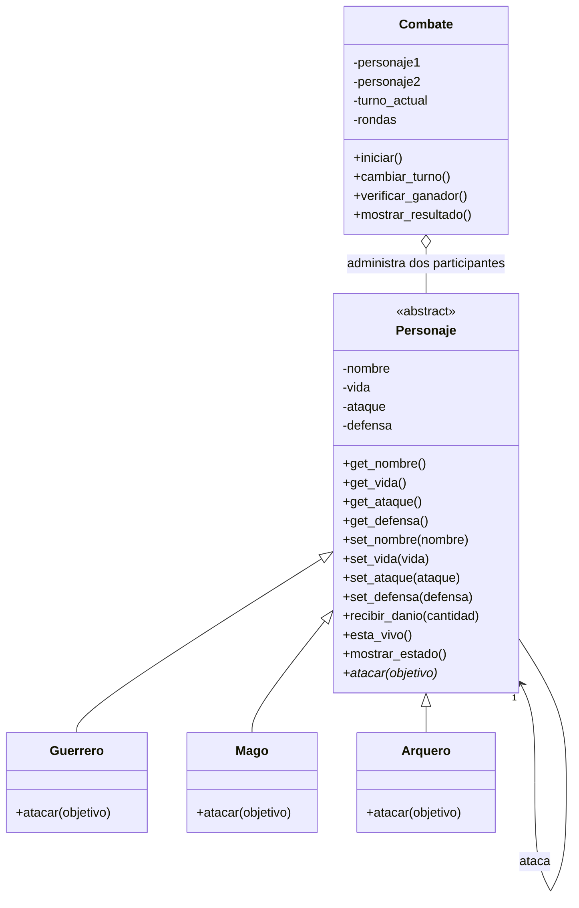

# Guardians of the Ancient Kingdom

Proyecto en Python para simular combates por turnos entre Guerreros, Magos y Arqueros, aplicando programación orientada a objetos.

## Archivos del proyecto

- `personajes.py`: contiene `Personaje`, `Guerrero`, `Mago`, `Arquero` y `Combate`.
- `main.py`: ejecuta una demostración de combate y muestra las habilidades.
- `test_personajes.py`: pruebas automatizadas con Pytest.

## Clases y responsabilidades

- **Personaje:** clase abstracta que define nombre, vida, ataque, defensa, validaciones, recepción de daño y estado.
- **Guerrero:** aumenta su ataque un 20 % y luego descuenta la defensa del objetivo.
- **Mago:** realiza daño igual a su ataque e ignora la defensa del objetivo.
- **Arquero:** duplica el daño base cuando su ataque supera la defensa enemiga.
- **Combate:** administra los turnos, revisa si hay ganador y finaliza al derrotar a un personaje, detectar empate técnico o llegar al límite de rondas.

## Conceptos de POO

- **Abstracción:** `Personaje` define la estructura común sin implementar el ataque específico. Su método `atacar()` es abstracto.
- **Encapsulamiento:** los atributos se guardan como atributos privados y se consultan o cambian mediante getters y setters que validan los datos.
- **Herencia:** `Guerrero`, `Mago` y `Arquero` heredan las características de `Personaje`.
- **Polimorfismo:** `Combate` llama a `atacar()` sin tener que comprobar qué tipo concreto de personaje está actuando.

## Relaciones entre clases

- **Herencia:** Guerrero, Mago y Arquero son tipos de Personaje.
- **Asociación:** un personaje interactúa con otro cuando lo ataca.
- **Agregación:** `Combate` administra dos personajes que se crean antes e independientemente del combate.

## Diagrama de clases UML



## Lógica del combate

Cada personaje ataca por turnos. El daño se calcula según la habilidad de su clase. La vida no puede ser negativa y un personaje derrotado no puede atacar. El combate termina cuando hay un ganador, si ambos ataques consecutivos causan cero daño o al alcanzar 50 rondas.

## Cómo ejecutar el programa

Se requiere Python 3. Para iniciar la demostración, abre una terminal dentro de esta carpeta y ejecuta:

```bash
python main.py
```

En algunos equipos de Windows, el comando puede ser:

```bash
py main.py
```

## Pruebas automatizadas con Pytest

Instala Pytest si no está instalado:

```bash
python -m pip install pytest
```

Ejecuta las pruebas:

```bash
python -m pytest -v
```

Las pruebas comprueban la creación de personajes, los valores inválidos, las tres habilidades, la vida mínima, la imposibilidad de atacar derrotado, el ganador y el empate técnico.

## Reto de abstracción

`atacar()` debe ser abstracto porque no todos los personajes calculan el daño de la misma manera: el Guerrero potencia el ataque, el Mago ignora la defensa y el Arquero puede duplicar el daño. La clase base no debe imponer una sola fórmula que no represente a todas las clases hijas. En cambio, `recibir_danio()` puede implementarse en `Personaje` porque todos comparten la misma regla para reducir la vida, impedir valores negativos y devolver el daño realmente recibido. Así se evita repetir lógica y se aprovechan la abstracción y la herencia; el combate utiliza el polimorfismo al llamar al método `atacar()` de cualquier personaje.

## Resultados de verificación

Ejecuta las pruebas en tu propio equipo y conserva el resultado real que muestre la terminal. No se debe presentar un resultado de pruebas que no se haya ejecutado en el equipo donde se entrega.
